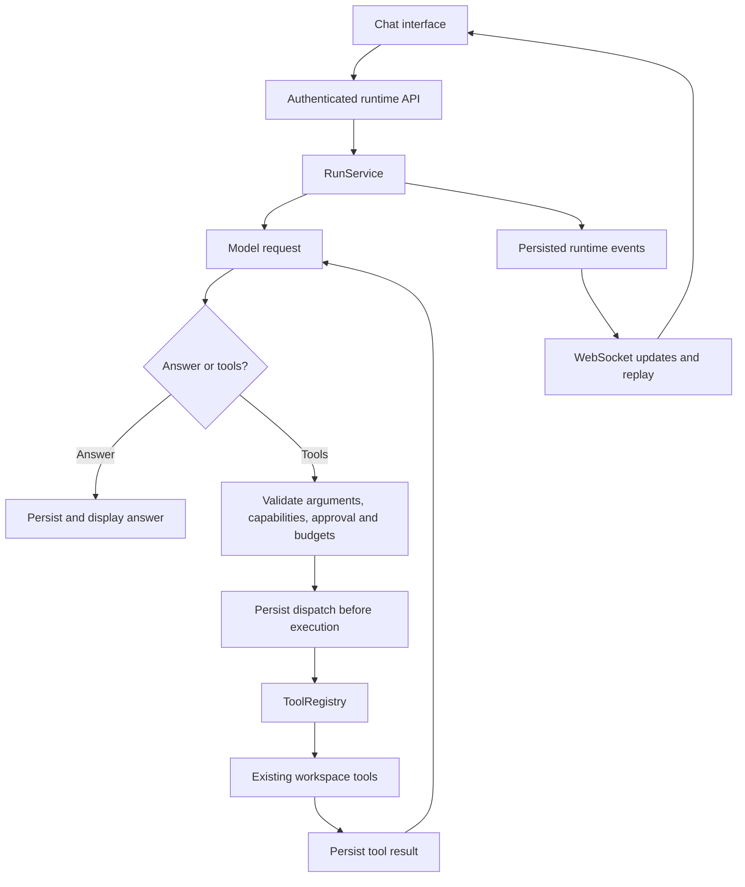
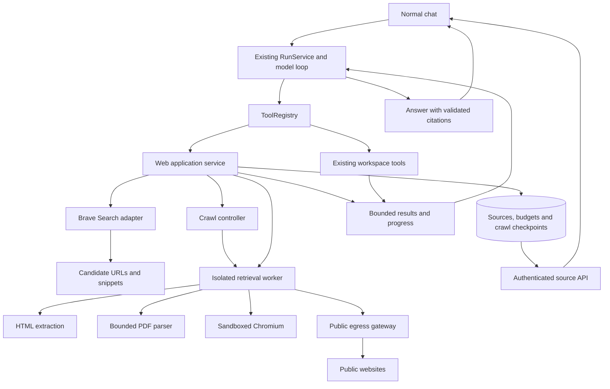
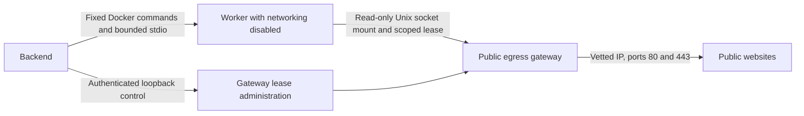

# Web search, page reading, and bounded crawling

This document defines the Stage 7 implementation contract. The branch stack in
[the delivery guide](stage-7-stack.md) records implementation and verification.
The diagrams below distinguish the existing runtime from the planned additions.

## Why the capabilities are separate

Search discovers candidate pages. Reading retrieves a page and extracts useful
content. Crawling selects and follows links across a bounded public scope.
A search snippet does not prove that Trellis read the supporting page.

Stage 7 adds these capabilities to normal chat. The existing agent chooses tools
and continues reasoning with their results. Deep research, scheduled collection,
login flows, transactions, and authenticated browsing are outside this stage.

Brave supplies search results through an operator-owned API key. The OpenAI key
pays for model usage independently. Direct retrieval avoids a crawler vendor's
per-page fee but still consumes compute, bandwidth, storage, and model tokens.
Application limits control Trellis's usage. Provider account billing controls
remain authoritative when a key is shared with other applications.

## The existing loop

`RunService` owns model calls, tool dispatch, budgets, cancellation, persistence,
and recovery. `ToolRegistry` validates registered tools and their capabilities.
Runtime events already reach the frontend through WebSocket JSON-RPC and replay.

The foundation change separates web capabilities from workspace capabilities.
A web-only configuration must not enable filesystem or command execution.
Workspace execution handling applies only to registrations that require it.

Generic tools receive a frozen execution context created after durable dispatch.
The context carries trusted user, conversation, run, tool, attempt, generation,
deadline, and allowance identities. It also provides active-run revalidation.
These values are not model arguments. A workspace root is present only for a tool
that requires workspace access.

## The web integration

The application service owns authorization, shared allowances, source recording,
and crawl orchestration. Provider and worker adapters implement narrow protocols.
Domain types remain independent of FastAPI, Supabase HTTP details, and browser
SDK types. The retrieval worker never receives the application's model keys,
database credentials, workspace mounts, browser profile, or Docker socket.

The first supported deployment runs an isolated Docker/Linux worker beside the
backend. Other deployments require equivalent isolation. Readiness fails closed
when required network restrictions, migrations, or worker components are absent.

### Tool responsibilities

| Tool         | Input                                    | Result                                                                 |
| ------------ | ---------------------------------------- | ---------------------------------------------------------------------- |
| `web_search` | Query and bounded result count           | Candidate titles, URLs, snippets, and provider outcome                 |
| `web_read`   | At most five URLs                        | Recorded source IDs, bounded excerpts, metadata, and per-page outcomes |
| `web_crawl`  | Seed, fixed scope, page and depth limits | Collected source IDs, progress, failures, and stopping reason          |
| `web_source` | Source ID and line range                 | Stable recorded lines visible to the current conversation              |

Tool results remain valid bounded JSON below the existing tool-result ceiling.
Complete source text stays in evidence storage. Page bodies and full frontiers
never enter progress events. Search results are untrusted discovery data.

### An ordinary comparison request

1. The existing run starts and the model searches if URLs are missing.
2. The model requests supporting pages through `web_read`.
3. The service reserves shared allowances before worker dispatch.
4. The worker fetches and extracts within network and process limits.
5. The service records accepted evidence and stable source lines.
6. The model inspects relevant lines and produces source references.
7. Trellis validates references before accepting the final answer.
8. The existing chat displays the answer, progress, and source viewer.

Crawling adds a persisted frontier to this flow. It remains attached to the
ordinary run. Exhaustion returns partial evidence and a stopping reason.
A later user continuation can grant another allowance. Crash recovery preserves
consumed allowances and cannot silently renew them.

## Evidence and recovery

Ownership follows the existing user, conversation, run, and tool identities.
Every source read, reuse, citation lookup, and mutation checks that ownership.
There is no shared evidence cache across users.

Bounded extracted text lives in Postgres for this release. Raw documents and
browser artifacts are transient. Successful source content is immutable.
Refetching creates a new version instead of changing evidence behind an answer.

The backend removes configured application credentials before source persistence.
Matching covers credentials split by canonical line wrapping, so separate line
requests cannot reconstruct a filtered credential. Metadata and blocked input
URLs receive the same filtering. The worker never receives the application's
credential list.

A filtered citable source has status `partial` and error code
`sensitive_content_redacted`. Its content hash identifies the accepted, stored
text after filtering and canonicalization. Clean source text keeps its normal
hash. Citation lines always refer to the immutable accepted version.

The storage contract preserves these records.

| Record            | Preserved information                                                                                                                                             |
| ----------------- | ----------------------------------------------------------------------------------------------------------------------------------------------------------------- |
| Sources           | Ownership, run/tool identity, requested/final/canonical URLs, title, available publisher/date, fetch time, extractor version, content hash, stable lines, outcome |
| Crawls            | Scope, parent run, dispatch generation, limits, counters, checkpoint, status, stopping reason                                                                     |
| Crawl pages       | Normalized URL, depth, state, attempt, reservation, resulting source                                                                                              |
| Shared web ledger | Reserved and consumed searches, page attempts, requests, bytes, and storage                                                                                       |
| Citation bindings | Answer/message reference, source ID, valid line range                                                                                                             |

Missing publication metadata remains missing. Fetch time is not publication time.
A failed retrieval cannot become a successfully fetched citation.

Reservations and attempts are durable before external requests. Page completion
and budget changes are atomic where they share an invariant. Generation checks
reject stale writes. Interrupted requests are charged conservatively because
exactly-once HTTP requests cannot be guaranteed after a crash.

Checkpointed recovery requires coherent Python and additive SQL changes.
The existing recovery constraints and dispatch RPCs enumerate local policies.
Labeling a crawl as an ordinary read-only tool would replay too much work.

### Citations and retention

The answer uses structured references such as
`[[source:<source-id>:L12-L20]]`. Validation checks ownership, conversation,
successful retrieval, available content, and the requested line range.
Streaming tolerates incomplete markers. Invalid final references trigger bounded
correction or an explicit missing-support outcome.

The source viewer loads authenticated conversation-scoped metadata and lines.
Valid references identify evidence. They do not automatically establish that a
claim follows from that evidence, so acceptance fixtures also check support.

Sources remain until cleared, subject to quota. Clearing requires the active run
to finish or be cancelled. It removes source content and identifying metadata,
increments the evidence generation, and fences delayed writers. Minimal source
tombstones let old answers display "Source removed" without reusing an identity.
Clearing evidence does not erase earlier answers or excerpts already saved in
the conversation's tool history.

## Security boundaries

### Public network requests

Allow HTTP and HTTPS on ports 80 and 443 initially. Reject credentials in URLs,
ambiguous authorities, unsupported schemes, and malformed hosts. Cover IPv4,
IPv6, mapped addresses, loopback, private, link-local, metadata, reserved, and
other non-public destinations.

Validate all DNS answers and connect to a vetted address. Preserve the original
hostname for the Host header, TLS server name, and certificate verification.
Validate each redirect against network policy and crawl scope before following
it. Disable environment proxy inheritance. Website requests use separate clients
without application credentials or cookies.

Bound raw response bytes, decoded bytes, redirects, duration, and request count.
Content-Length is only an early hint. Incremental decoding must stop compression
bombs before full expansion. Unsupported encodings fail explicitly.

These controls follow the layered application and network approach described in
[OWASP's SSRF prevention guidance](https://cheatsheetseries.owasp.org/cheatsheets/Server_Side_Request_Forgery_Prevention_Cheat_Sheet.html).

### Worker and browser execution

Use a non-root worker with a restricted filesystem, temporary scratch space,
CPU, memory, process, and execution limits. The application invokes fixed typed
operations, never model-supplied code. Chromium sandboxing remains active.
PDF parsing has separate time, memory, page, and text limits. Encrypted files
and scanned documents requiring OCR return accurate unsupported outcomes.

Docker alone does not enforce public-only destinations. Worker networking must
restrict outgoing connections to the public-egress gateway. The gateway validates
actual destinations. Enforced network rules also block direct DNS, UDP, QUIC,
host access, and browser paths that bypass the proxy. Browser-layer tests must
cover script, frame, WebSocket, and service-worker requests. Worker readiness fails closed if these
requirements cannot be enforced.

The retrieval implementation uses a fresh worker with Docker `--network none`.
The backend supplies bounded JSON through fixed Docker commands. The worker
mounts only the gateway's Unix socket volume, read-only. The socket is shared
between Linux containers inside Docker, avoiding host socket sharing on macOS.
An authenticated gateway control listener is published on host loopback only.
The worker receives an operation lease instead of the control credential.

The gateway installs a kernel egress policy before dropping privileges. Its DNS
exception covers the actual Docker resolver translation and the gateway's user.
The hostname resolver uses cancellable asynchronous DNS. Address checks reject
reserved and transitional ranges even when Python reports `is_global` as true.
The connection uses a vetted numeric address and verifies the socket peer.

The gateway independently bounds tunnel count, lifetime, and bytes forwarded
through the tunnel. The durable response-byte reservation must cover that entire
transport allowance, including TLS overhead. Confirmed gateway receipts determine
settlement. Missing receipts keep the conservative reservation charged.
Tunnel bytes are application-level transport bytes, not TCP/IP packet accounting.

Encrypted tunnels do not reveal every HTTP request, redirect, or decoded response.
The fixed reader and later renderer enforce those limits. The gateway does not
prove exact HTTP request accounting or GET-only behavior against a compromised
browser process. Public-only egress, transport limits, process limits, and lease
expiry remain independent controls.

The reader uses the already locked `h11` package for bounded HTTP framing.
The gateway uses the already locked `dnspython` package for cancellable DNS.
Both are direct, pinned dependencies because this security boundary relies on
their APIs. Deployment requirements also pin package hashes.

Run `uv run --locked python -m scripts.verify_web_isolation` from `backend/` to
exercise the actual Docker boundary. Run one proof per Docker daemon because the
isolated fixture reserves `93.184.216.0/24`. The proof removes its temporary
containers, networks, volume, certificates, and derived images. It retains the
production images and reports their immutable IDs.

Cancellation closes sockets and terminates outstanding processes. Timing out an
await while leaving a browser or parser running does not satisfy cancellation.

### Untrusted content and remaining limits

Extracted content remains tool data. A page cannot grant tools, permissions,
or system instructions. Previews escape content, constrain links, and avoid
executing scripts or automatically loading remote images. Logs contain safe
operational metadata rather than credentials, raw content, or sensitive queries.

Normal chat may combine private workspace context and public query generation.
Narrow tools, minimal queries, secret-aware handling, and explicit untrusted
content boundaries reduce risk. They do not prove confidentiality against all
model-generated exfiltration. This limitation remains visible in the operator
documentation. The worker protects application secrets and internal networks.

## Crawl policy and default limits

Fix the allowed origin and optional path prefix when a crawl begins. Normalize
and deduplicate URLs. Record off-scope links without following them. Revalidate
redirects. Apply robots/access rules, per-origin pacing, and bounded retries.
[RFC 9309](https://www.rfc-editor.org/rfc/rfc9309.html) defines robots handling.
Robots rules do not grant authorization to access a resource.

| Limit                      | Initial value                             |
| -------------------------- | ----------------------------------------- |
| Search results             | 5 default, 10 maximum per search          |
| Search calls               | 5 per run                                 |
| URLs per read              | 5                                         |
| Attempted pages            | 20 across the run                         |
| Crawl depth                | 2                                         |
| Queued crawl URLs          | 200                                       |
| Concurrent target requests | 2, with at most 1 browser render          |
| HTTP duration              | 30 seconds, capped by parent deadline     |
| Browser duration           | 60 seconds, capped by parent deadline     |
| Redirects                  | 5                                         |
| HTML size                  | 2 MiB transferred, 4 MiB decoded          |
| PDF input                  | 16 MiB, at most 100 pages processed       |
| Response data              | 64 MiB across the run                     |
| Network requests           | 300 across the run, at most 75 per render |
| Extracted text             | 256 KiB per source, 8 MiB per run         |
| Retained extracted text    | 100 MiB per user                          |
| Transient retries          | At most one, none for policy rejection    |

Tools share the ledger, so repeated calls cannot multiply these ceilings.
Brave has a separately configured application usage ceiling. Missing credentials
produce an explicit unavailable result without a silent provider fallback.

Search uses Brave's fixed
[POST endpoint](https://api-dashboard.search.brave.com/api-reference/web/search/post)
with the query in a JSON body. A dedicated client disables environment proxies,
cookies, and redirects. Search snippets remain discovery data.

The search meter reserves an attempt before provider I/O. It shares a key hash
and database-clock UTC month across users and backend restarts. The default
ceiling is 1,000 attempts per key per month, and configuration can lower it.
Interrupted requests and provider errors retain their monthly charge.
Clearing sources does not reset that allowance. The private meter exposes no
shared-key usage records through ordinary authenticated table reads.

Run cost totals cover model usage. Brave billing is separate, and the provider's
account controls remain authoritative. A shared key used outside Trellis or a
different provider billing period can differ from Trellis's meter. The ceiling
does not promise a zero provider bill. Brave's response counter measures bounded
application payload bytes. Source gateway receipts measure forwarded transport
bytes, including TLS, rather than physical packet traffic.

## Acceptance criteria

The implementation is complete when fresh checks demonstrate these outcomes.

1. Normal chat discovers and actually retrieves supporting pages for a comparison.
2. Answers cite recorded source lines and expose accurate retrieval failures.
3. HTML, text PDFs, and public JavaScript pages can be read within limits.
4. Forbidden destinations receive no connection, including browser subrequests.
5. A large website stops within its scope and shared allowance.
6. Cancellation and recovery preserve completed work without renewing budgets.
7. Cross-user and cross-conversation source access fails under real RLS tests.
8. Clearing sources prevents late writes and marks historical citations unavailable.
9. Embedded source instructions do not grant permissions or privileged execution.
10. Existing workspace tools and approval behavior remain intact.

Backend verification uses `make check` with uv 0.12.5. Frontend verification uses
the existing lint, type checks, build, and focused browser checks. Network and
database evidence must exercise the real isolation and RLS boundaries.
Unavailable checks are reported as unverified, not passed.
